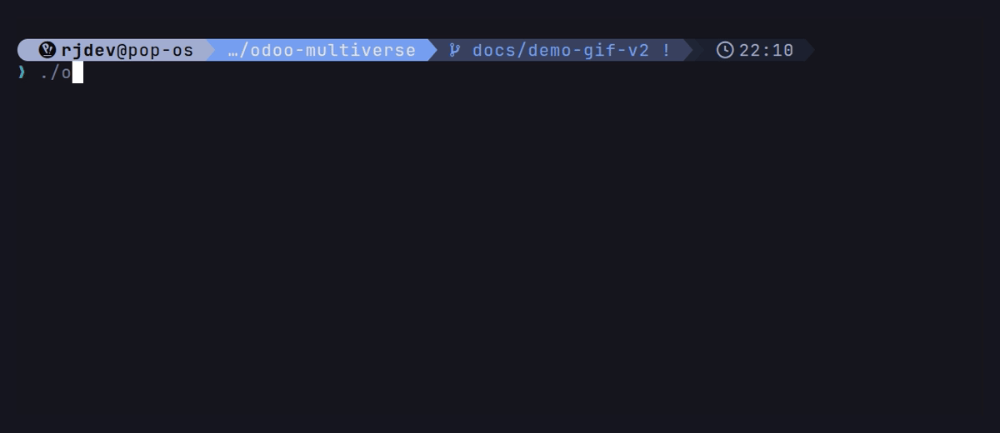

# odoo-multiverse

**Run Odoo 16 → 20 side by side. Demo data, disposable test databases, source tracing. Built for developers and AI agents.**

[](https://github.com/rjvdev/odoo-multiverse/actions/workflows/ci.yml)
[](LICENSE)

[Version française](README.fr.md)



## The problem

If you maintain Odoo modules, you rarely work on a single version. A customer is on 16, another one is moving to 18, and 19 and 20 change APIs you relied on. Keeping one `odoo-bin` setup per version means juggling virtualenvs, Python versions and system libraries. Test databases pile up. Checking whether a method still exists in 19 turns into a guessing game, and AI coding agents fill the gaps by guessing.

odoo-multiverse gives you all five versions behind one command:

- **One stack**: a shared Postgres 16 and one official `odoo:<v>.0` image per version, each on its own local port.
- **Demo data everywhere**: loaded by default on every version, including 19 and 20, where Odoo made it opt-in.
- **Disposable test databases**: `odoomv test 18 my_module` installs your module in a fresh `scratch18_my_module` database, runs its tests, prints a clear verdict with a reliable exit code, and drops the database, even when tests fail.
- **Your modules, from anywhere**: `odoomv link` copies a module from any repository into the lab, and `install`, `update` and `test` resync it automatically.
- **Source at hand**: `odoomv src 19` copies the exact Odoo code shipped in the image, so you (or your agent) can grep the real thing instead of guessing.
- **Agent-ready**: a `CLAUDE.md` guide and a Claude Code skill tell AI agents how to use the lab safely: allowed databases, verdict lines, version differences.

## Install

Requirements: Docker Engine with Compose v2, bash, rsync. Python 3 is only needed for `odoomv trace`.

```sh
git clone https://github.com/rjvdev/odoo-multiverse ~/odoo-multiverse && ~/odoo-multiverse/odoomv up 16
```

Then create the database and check that everything works:

```sh
~/odoo-multiverse/odoomv init 16
~/odoo-multiverse/odoomv test 16 lab_selftest   # last line: OK: 2 tests, 0 failed, 0 error(s)
```

Odoo 16 now answers on http://127.0.0.1:8016 (`admin` / `admin`).

Optional: put `odoomv` on your `PATH`.

```sh
ln -s ~/odoo-multiverse/odoomv ~/.local/bin/odoomv
```

## Commands

`<v>` is 16, 17, 18, 19 or 20. `up`, `down`, `restart` and `src` accept several versions (`odoomv up 16 18 20`).

| Command | What it does |
|---|---|
| `odoomv up <v>...` | Start Postgres and Odoo `<v>` |
| `odoomv down [<v>...]` | Stop Odoo `<v>`, or the whole lab without argument (volumes kept) |
| `odoomv restart <v>...` | Restart Odoo `<v>` if it is running |
| `odoomv init <v> [--no-demo]` | Create the `odoo<v>` database with `base` installed and demo data |
| `odoomv install <v> <mods> [db]` | Install modules (comma-separated) |
| `odoomv update <v> <mods> [db]` | Update modules |
| `odoomv test <v> <module>` | Run a module's tests in a disposable database |
| `odoomv link <v> <path>` | Copy a module from another project into `addons/<v>/` |
| `odoomv unlink <v> <module>` | Remove that copy (the source is untouched) |
| `odoomv shell <v> [db]` | Odoo shell, accepts a script on stdin |
| `odoomv psql <v> [db]` | psql on the database, accepts SQL on stdin |
| `odoomv logs <v> [-f]` | Odoo logs |
| `odoomv src <v>... [--force]` | Copy Odoo's source code from the image into `src/<v>/odoo` |
| `odoomv trace <v> <args...>` | Find where a model, field or method is defined (needs [agent-skills](https://github.com/unclecatvn/agent-skills)) |
| `odoomv status` | Containers, databases, ports |

Details, guard rails and failure criteria are in [`CLAUDE.md`](CLAUDE.md).

## Supported versions

| Version | Image | URL | Demo data by default (native Odoo) | Notes |
|---|---|---|---|---|
| 16 | `odoo:16.0` | http://127.0.0.1:8016 | yes | |
| 17 | `odoo:17.0` | http://127.0.0.1:8017 | yes | |
| 18 | `odoo:18.0` | http://127.0.0.1:8018 | yes | |
| 19 | `odoo:19.0` | http://127.0.0.1:8019 | no (odoomv adds `--with-demo`) | |
| 20 | `odoo:20.0` | http://127.0.0.1:8020 | no (odoomv adds `--with-demo`) | Access rights move to `ir.access` (`security/ir.access.csv`) |

Only Odoo Community images are used.

## Use with AI agents

- **Claude Code plugin**: the repository ships a skill that teaches an agent to test modules on the lab from any project.

  ```
  /plugin marketplace add rjvdev/odoo-multiverse
  /plugin install odoo-multiverse@odoo-multiverse
  ```

  The plugin only installs the skill. Clone the lab as shown above, in `~/odoo-multiverse`.
- **Any agent**: point it to [`CLAUDE.md`](CLAUDE.md). It lists the commands, the allowed databases, the verdict lines and the known differences between versions.
- **Source tracing**: with the [agent-skills](https://github.com/unclecatvn/agent-skills) plugin installed, `odoomv trace 19 method res.partner name_get` answers FOUND with `file:line`, or NOT FOUND with close names, against the real code of that version.

## FAQ

**Do I need Claude or any AI tool?**
No. `odoomv` is a plain bash script on top of Docker Compose. The skill, the plugin and `trace` are optional.

**Does it support Odoo Enterprise?**
No, only the official Community images. You can still `link` your own modules, including modules that depend on code you provide.

**macOS?**
Yes, with Docker Desktop.

**Windows?**
Use WSL2. `odoomv` is a bash script: clone the repository inside the WSL file system (for example `~/odoo-multiverse`, not `/mnt/c/...`) and run it from a WSL shell with Docker Desktop's WSL integration enabled. The repository enforces LF line endings, so the script is not broken by CRLF conversion.

**It worked yesterday and fails today. Why?**
The `odoo:<v>.0` tags are rebuilt upstream, often nightly, so the image behind a tag can change from one day to the next. Run `docker image inspect odoo:16.0 --format '{{index .RepoDigests 0}}'` to see the digest you are running. If you need a fixed version, pin it in `compose.yml` (`image: odoo:16.0@sha256:...`).

**How much disk space does it take?**
Each Odoo image takes 2.6 GB (16) to 3.5 GB (20), plus 0.6 GB for Postgres. Copying the source with `odoomv src` adds 1.2 to 1.6 GB per version. You only pay for the versions you start.

**A port is already in use.**
Each version uses `127.0.0.1:80<v>` (8016 to 8020). Stop whatever listens there, or change the port in `compose.yml`.

**Why is demo data loaded by default?**
Most tests, including Odoo's own, rely on it. Use `odoomv init <v> --no-demo` for an empty database. `odoomv test` always loads demo data.

**Are the default credentials a risk?**
`admin` / `admin` and `odoo` / `odoo` are meant for a disposable local lab. Ports are bound to `127.0.0.1` only. Do not expose them on a network and do not load real customer data.

## Contributing

Contributions are welcome. See [CONTRIBUTING.md](CONTRIBUTING.md) and the [Code of Conduct](CODE_OF_CONDUCT.md). To report a vulnerability, see [SECURITY.md](SECURITY.md).

## License

[MIT](LICENSE)

---

**Not affiliated with Odoo S.A.** Odoo is a trademark of Odoo S.A. This project only uses the official public Docker images.
